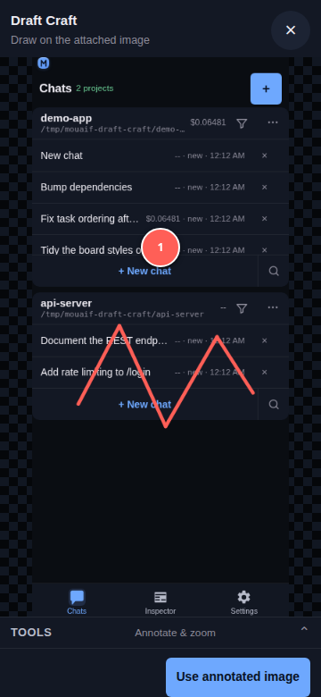
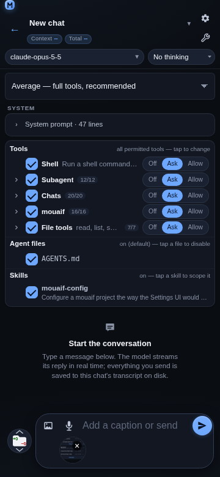
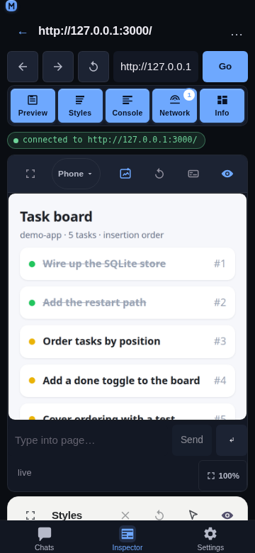
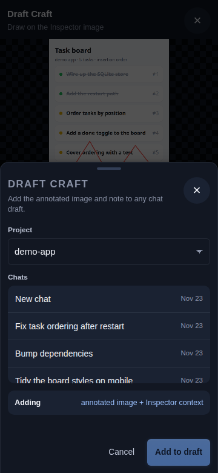
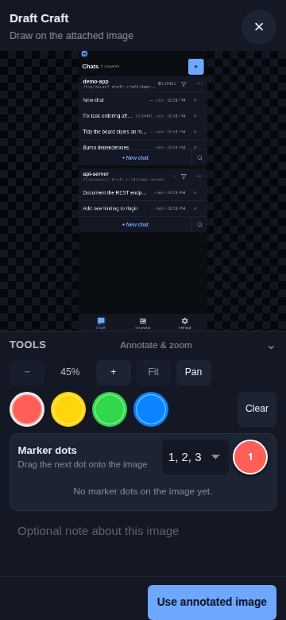
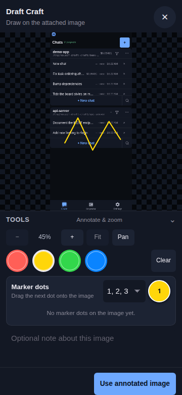
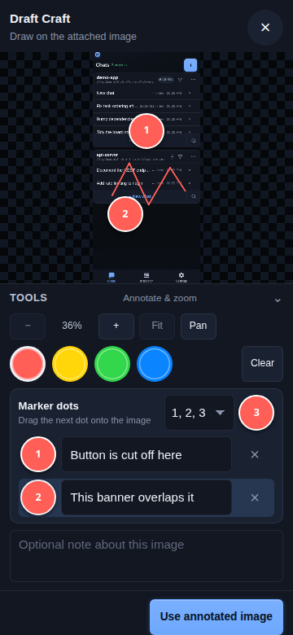
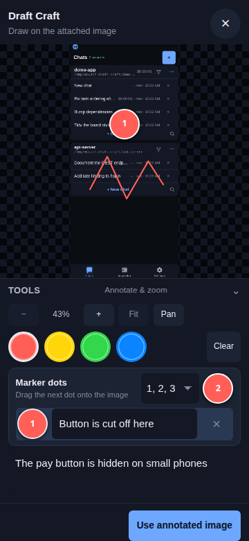
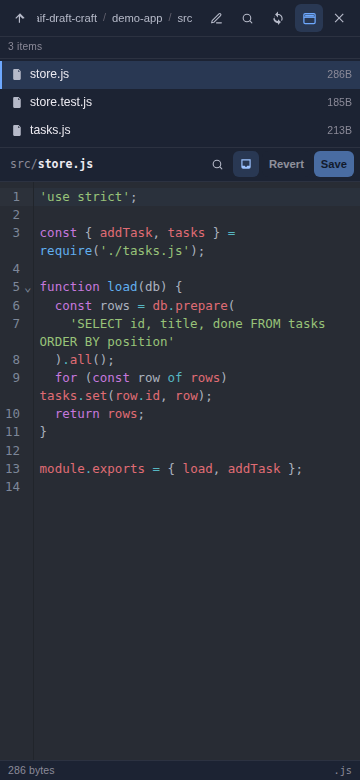

# Draft Craft

## Overview

Draft Craft adds material to a chat draft without sending it: an annotated image, code selected in the file editor, or an Inspector log / network entry. You always review the draft and press send yourself.



## Pick your starting point

Every path ends the same way: the material lands in a chat draft, and nothing is sent until you send it.

- **An image already in the composer, marked up** — start from the image chip. Go to [Path A](#path-a-mark-up-an-attached-image).
- **A marked-up screenshot of a web page** — start from **Inspector** → **Preview**. Go to [Path B](#path-b-mark-up-an-inspector-page).
- **Lines of code from a project file** — start from the chat file toolbar → **Files**. Go to [Path C](#path-c-add-selected-file-code).
- **A console log, exception, or network request** — start from the **Inspector** detail sheet. Go to [Path D](#path-d-add-an-inspector-entry).

## Path A: mark up an attached image

Use this when the image is already in the chat you want to send it from.



1. **Attach the image.** In the composer, tap the **add image** button, paste an image, or drag one in. It shows as a chip above the text field.
2. **Open the annotator.** Tap the image chip. The annotator opens with the title *Draw on the attached image*.
3. **Mark up the image.** Follow [Mark up the image, step by step](#mark-up-the-image-step-by-step).
4. **Finish.** Tap **Use annotated image**. The marked-up version replaces the attachment, and the annotation text is added to the draft.
5. **Review and send.** Edit the draft text if you like, then send as usual.

To undo, tap the chip again and tap **Reset**: the original image comes back and its annotation text is removed from the draft. Annotating the same image again replaces its previous annotation text instead of adding a second copy.

## Path B: mark up an Inspector page

Use this to send a screenshot of the page you are debugging to any chat.



1. **Connect.** Open the **Inspector** tab and connect to a browser tab.
2. **Open the annotator.** In the **Preview** panel's toolbar, tap the blue **Draft Craft** icon — the only blue button in the row, between the size picker and **Refresh preview**. The current page screenshot opens in the annotator.
3. **Mark up the image.** Follow [Mark up the image, step by step](#mark-up-the-image-step-by-step).
4. **Finish.** Tap **Add to chat draft**.
5. **Choose where it goes.** Pick a **Project**, then a chat, and tap **Add to draft**. The sheet confirms with *Added with Draft Craft.*
6. **Review and send.** Open that chat: the image is attached and the text is in the draft, ready to send.



The text added with an Inspector image starts with the page title and URL, so the model knows which page it shows.

## Mark up the image, step by step

Paths A and B open the same annotator: the image on top, the **Tools** panel under it, and the finish button at the bottom. Work down the panel from top to bottom. Every step is optional — skip what you don't need.

**Quick version:** pick a color → draw on the image → drag a dot onto the image → type what the dot points at → tap the finish button.

### Step 1: find your way around



The panel shows, from top to bottom:

| Row | What it does |
|-----|--------------|
| **Tools** *(Annotate & zoom)* | Tap to hide or show the panel. Hide it to give the image the whole screen. |
| **− 45% + Fit Pan** | Zoom out, the zoom level, zoom in, show the whole image again, and switch between moving the image and drawing. |
| Four color circles and **Clear** | The color for strokes and new dots. **Clear** wipes every stroke and dot. |
| **Marker dots** | The numbered dot you drag onto the image, and the list of dots you placed. |
| **Optional note about this image** | A general comment sent with the image. |

**Zooming in on a detail:** tap **+**, or pinch with two fingers on the image. To move a zoomed image, tap **Pan** and drag, then tap **Draw** to draw again. Tap **Fit** to see the whole image.

### Step 2: pick a color and draw



1. Tap a color circle. The chosen one gets a white ring.
2. Drag a finger on the image to circle or underline what matters.

If **Pan** is highlighted, dragging moves the image instead — tap it to switch back to **Draw**.

### Step 3: place numbered dots and describe them



Use dots when you want to say something about several spots.

1. **Choose the labels** (optional): **1, 2, 3** or **A, B, C** in the menu next to the dot.
2. **Drag the colored dot** at the right of **Marker dots** onto the image. It lands with the next label, and a new row appears in the list.
3. **Type what it points at** in that row's **Text for 1** field.
4. Repeat for each spot — up to 26 dots per image.

To move a dot, drag it on the image. To pick one, tap its label in the list (the row is highlighted). To delete one, tap **×** on its row.

### Step 4: add a note and finish



1. Type a general comment in **Optional note about this image**, if you have one.
2. Tap the button at the bottom: **Use annotated image** (Path A) or **Add to chat draft** (Path B), then go back to step 4 of your path.

Made a mess? **Clear** removes all strokes and dots so you can start again from the clean image.

### What ends up in the draft

- The image, with your strokes and labeled dots drawn in.
- A short text block: the source (*Attached image* or *Inspector image*), the page title and URL for Inspector images, your note, then an **Annotations:** list with one line per dot.

```text
Inspector image
Checkout – Shop
https://example.com/checkout
The pay button is hidden on small phones
Annotations:
1. Button is cut off here
2. This banner overlaps it
```

## Path C: add selected file code

Use this to point the model at exact lines of a file.



1. **Open the file.** In a chat, open the file toolbar, choose **Files**, and open a text file.
2. **Select the code.** Select the lines you want in the editor.
3. **Tap Draft Craft.** It sits in the open file's display bar, beside the file actions.
4. **Choose where it goes.** Pick a project and a chat, then tap **Add to draft**.
5. **Review and send.** Open the chat and add your question around the code.

Only the file path with its line range and the selected code are added — no extra prose and no code fence.

## Path D: add an Inspector entry

1. **Open the entry.** In the **Inspector**, tap a row in the **Console** or **Network** panel — a log, an exception, or a request. Its detail sheet opens.
2. **Tap Add to chat** in the sheet's header, next to **Close**.
3. **Choose where it goes.** Pick a project and a chat, then tap **Add to draft**.
4. **Review and send.** Open the chat and send when ready.

See [Add Inspector entries to a chat](inspector-add-to-chat.md) for the exact text it adds.

## Good to know

- **Nothing is sent automatically.** Draft Craft never starts a model run.
- **Your draft is kept.** Existing text and attachments stay; Draft Craft only adds.
- **Eight images per draft.** The limit counts Draft Craft images and the ones you attached yourself.
- **Large images are shrunk.** An exported image that is too large is downscaled. If an image cannot be exported at all, the annotator stays open with an error, so nothing is added without it.
