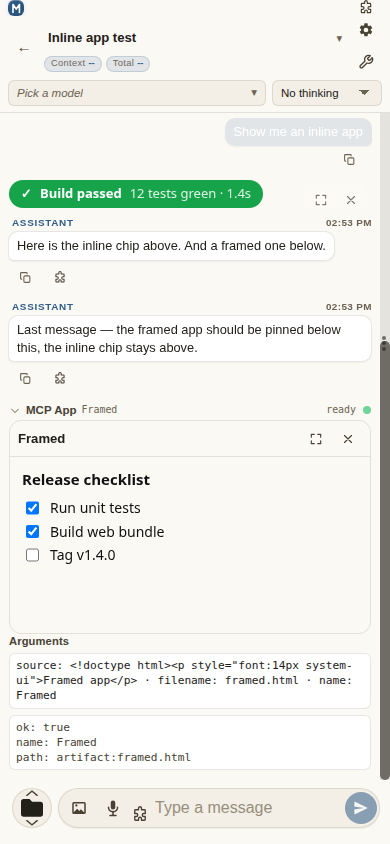

# MCP Apps

## Overview

MCP Apps are interactive HTML tool views inside the conversation, as described by the [official MCP Apps overview](https://modelcontextprotocol.io/extensions/apps/overview). mouaif uses the official AppBridge SDK to connect these views to their serving MCP server, with sandbox isolation and the existing tool authorization gate.

## Usage

1. MCP Apps are always available for compatible project MCP tools; there is no project enable/disable switch. Legacy `mcpApps.enabled` values are ignored.
2. Start the relevant MCP server using its Settings lifecycle control. Restart servers connected before this update so they receive the Apps capability at initialization.
3. Call a tool declaring `_meta.ui.resourceUri`. Expand its completed tool card to load the app beside the ordinary text/image result. The latest mounted MCP App stays pinned at the bottom of the transcript as new messages arrive; earlier ones go back to their place in the chat and keep running there. Opening an app older than the pinned one runs it in its chat position.
4. Interact with the view. App tool calls use the server's Off/Ask/Allow policy; Ask displays the app/server identity and arguments on a normal approval card.
5. The app's header carries **two icon buttons** — the fullscreen toggle (press **Escape** too, for the mobile sheet) and **Close** to revoke a view — plus **Retry** after closure, tab hiding, a resource change or initialization failure. Each is a glyph with an `aria-label`/`title`, so no text label takes room from the app's title on a phone.



Inside the chat the framed app keeps the tool card's usual `17px` left indent, like every other expanded tool card; the frame itself carries no margin, and the header is a slim, transparent strip above the app rather than a second toolbar.

**Transparent inline apps.** An app can ask to blend into the conversation instead of sitting in a framed card: an on-the-fly app with `inline: true` on `create_mcp_app`, or a server app whose UI resource declares `_meta.ui.prefersBorder: false` (the spec's "no border and background" request). Such an app shows no tool-card header, frame border or title strip, and stays at its place in the chat instead of taking the bottom slot. Its fullscreen and Close glyphs float over the app's top-right corner, shown on hover or keyboard focus (always, faintly, on touch screens). If it fails or is closed, the normal header, reason, Retry and tool result come back. A later `create_mcp_app` call on the same `path` with `inline: false` puts the app back in its framed card at the bottom; leaving `inline` out keeps the current look.

App frames and sandbox wrappers have transparent backgrounds: unpainted app areas show the chat backdrop in inline mode. An app's own background is preserved; fullscreen retains its normal sheet backdrop. Transparency does not change sandbox isolation or permissions.

Views need no port but the app's own, over HTTP or HTTPS and behind a reverse proxy. A Docker install only has to publish the app port (`5732` by default). The single-use outer sandbox proxy is served at `/api/mcp/apps/sandbox/:token` with `Content-Security-Policy: sandbox allow-scripts`, so it runs in an opaque `null` origin. Unsupported app policies, stopped servers and initialization failures keep the ordinary tool result instead. The main app's port remains 5732 by default.

**App text messages are automatic:** a view can send `ui/message` with user text to its bound chat, starting a normal AI turn without another confirmation. The transcript labels the message with its app/server. This can consume provider credits; use interactive views only from servers you trust to initiate prompts. Disable their source tools through the existing tool permissions when needed. Existing tool approvals still apply to the AI's actions.

Only user-role text is accepted (up to 16 blocks and 16 KiB). Messages cannot select another chat/model or insert assistant/system authority. They are rejected while the chat is running and limited to one attempt per chat per 5 seconds, including across remounts. The app receives only an acknowledgement, never conversation history or the AI response. Once accepted, the turn continues if the view closes; use the normal chat Stop control to cancel it.

Camera, microphone, geolocation, clipboard, external links, downloads and model-context writes are not granted. Image/audio/resource messages remain unsupported.

For local single-file apps in the current chat or a request-to-development-chat workflow, see [On-the-fly MCP Apps](./on-the-fly-mcp-apps.md). Those apps can read their data from [chat artifacts](./chat-artifacts.md). On-the-fly apps reuse this host and its sandbox/messaging restrictions without registering an MCP server or tool.

## Official reference

The [official overview](https://modelcontextprotocol.io/extensions/apps/overview) is the entry point and source for the feature: tool metadata, UI resources, sandbox rendering, bidirectional JSON-RPC, consent and framework-independent apps. Its linked [AppBridge API](https://apps.extensions.modelcontextprotocol.io/api/modules/app-bridge.html) and [official specification](https://github.com/modelcontextprotocol/ext-apps/blob/main/specification/2026-01-26/apps.mdx) supply the wire details that the overview does not define.

The installed official SDK is pinned to `@modelcontextprotocol/ext-apps@2.0.3`, reviewed at `82221c0c8ce7661efa6771c9d461511b1650495f`, with extension protocol `2026-01-26`. The SDK version is not the protocol date. No third-party protocol summary is used.

## Security and supported behavior

- The outer proxy has an opaque origin, so it is cross-origin to the app even though it shares the port. Its inner app frame has an opaque origin and cannot read host DOM, cookies or storage, navigate the parent, or remove the outer sandbox.
- HTTP-header CSP defaults deny network connections. Validated public HTTPS resources and HTTPS/WSS connections can be allowed only when declared by the app. Host/private origins, wildcard rules, CSP fragments, nested frames, dedicated app domains and external base URIs are rejected in this initial host.
- The sandbox route serves only single-use, host-bound proxy tickets, and sets no cookies. App HTML arrives over a source-and-origin-checked message channel; proxy responses are `no-store`. Reload requires a fresh mount.
- **The proxy request carries the app's cookies.** The browser sends them when it loads the frame, which is also what lets the route pass the access login. The route does not reflect cookie or auth headers into HTML, responses or bridge messages. Once loaded, the proxy and the view have opaque origins: they cannot read cookies, and their default CSP denies network requests. Separate-hostname HTTPS hosting with a reviewed cookie policy remains required before production rollout; prefer a separate registrable domain.
- Every operation rechecks the live server generation, registered server, source-tool visibility/resource URI, tool Off settings and chat existence. Invalid mounts revoke their ticket and pending approvals; late tool results are not returned to a revoked app. APIs pin the mount's exact host origin, reject null/cross-site browser requests, and accept only the documented HTTP methods. No-Origin non-browser CLI access retains the ordinary access policy.
- AppBridge performs initialization. Tool input is delivered before the original result. Unknown/unimplemented requests are rejected; capabilities are not advertised merely because the overview lists them.
- Mount identities come from persisted tool call/result rows. The app cannot select another project, chat or server, or nominate its approval call ID. Only raw tools with app visibility on its own server are callable, through existing per-chat/per-tool authorization.
- Resource reads are session-scoped and bounded to 16 cached HTML resources of at most 1 MiB each. Updates invalidate the cache and mounted views detect resource/session changes; they fall back and offer Retry rather than injecting replacement HTML into an initialized app.
- Initialization has a 10-second timeout. Teardown requests wait at most 500 ms on explicit closure; navigation or recycled transcript rows use best-effort teardown because the browser may already remove the frame. Close/tab hide removes app approval UI and sends independent keepalive revocation; restore requires Retry. A 20-second server lease renewed by 5-second host polling bounds abandoned capabilities/approvals, with a 5-second sweep even if browser teardown fails. Absolute expiry is 30 minutes; limits prevent unbounded mount/call growth. Accepted automatic AI turns remain independent of app teardown.
- Inline views are width-constrained with bounded heights; fullscreen uses a safe-area sheet. Its header controls are compact glyph buttons (32 px, 28 px on a phone frame) whose accessible name is an `aria-label`; app-owned controls inside the frame keep their own sizing. Text/image results remain independent of app success.

## HTTP interface

All routes use the main app's normal access and same-origin authorization. Frame requests are proxied by the host; sandbox frames cannot call these APIs directly.

| Method | Route | Purpose |
| --- | --- | --- |
| POST | `/api/mcp/apps/mount` | Bind `{ projectDir, chatId, callId }` to a completed MCP tool result; return an isolated view mount, or disabled/fallback. |
| POST | `/api/mcp/apps/:mountId/call` | Call a bound server tool with `{ requestId, name, arguments }`; `409 EAUTH_REQUIRED` returns a server-generated approval request for the existing decision endpoint. |
| POST | `/api/mcp/apps/:mountId/message` | Accept `{ role: "user", content: [{ type: "text", text }] }` and automatically start the bound chat's normal AI turn; returns `{}` only. |
| POST | `/api/mcp/apps/:mountId/status` | Detect resource/session changes, expiry or revoked tool permissions. |
| POST | `/api/mcp/apps/:mountId/cancel` | Cancel a host request ID and its outstanding approval. |
| DELETE | `/api/mcp/apps/:mountId` | Revoke the mount and cancel outstanding calls. |

## Remaining capabilities

- Configured HTTPS sandbox hosting on a separate hostname without an extra browser-facing port.
- `ui/updateModelContext` and image/audio/resource-bearing messages.
- Host-controlled links, downloads and optional device permissions.
- App preloading/streaming tool inputs and resource subscriptions.
- Broader external-content policies (nested frames, dedicated domains and wildcard origins).

These are not enabled by automatic text messages; each needs its own implementation and security checks.

## Verification

Regression tests use a real stdio MCP fixture, actual HTTP mount/authorization routes, and the official App SDK inside Chrome with normal site isolation. The combined real-host test covers automatic message → attributed persisted prompt → normally approved MCP tool → actual SSE reply, Close/Retry and abandoned approval cleanup, normal Stop, draft preservation and 360/390/430 px. Cookie/auth sentinels, ticket replay, wrong host/origin/method, source/requested-tool Off, resource/visibility changes, server restart, chat deletion and abandoned leases are also checked. An isolated Docker test image runs the same checks without restarting the running host app.

Passing regressions are not a complete security audit. Remaining review includes real HTTPS/PWA hosting, malicious navigation and reload storms, approval races across multiple followers, and DNS rebinding/private addresses behind declared external hostnames. CSP origin syntax checks alone do not prove that a hostname resolves publicly.

```bash
docker build -f scripts/Dockerfile.mcp-apps -t mouaif-track-b-mcp-apps:test .
docker run --rm --shm-size=256m --cpus=1 --memory=768m --memory-swap=768m mouaif-track-b-mcp-apps:test
```

This test image uses the locally built `mouaif-app:latest` as its Chrome-equipped base; it does not modify that image or run its default server command.
