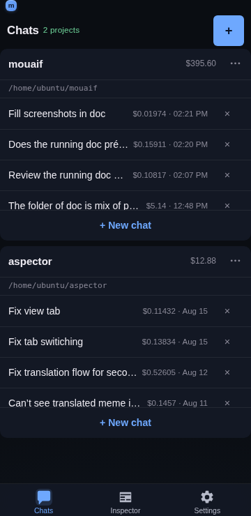

# Project card

## Overview

The Project card is the main organizational view in mouaif: each registered project appears as a card displaying the project name, path, list of chats, a "+ New chat" button, and a project options menu.

## Card features

- **Project header** — displays the project name and path, with an options menu (`⋯`) offering:
  - **Settings…** — opens the dedicated project settings page.
  - **Rename…** — updates the display name of the project.
  - **Unregister** — removes the project from mouaif without deleting any files on disk.
- **Scrollable chat list** — lists previous conversations sorted by most recently active. Each chat row displays:
- The conversation title.
- Total token cost and timestamp.
- A quick delete (`×`) action.
- **Draft-only chats** — a chat with no persisted messages but a non-empty composer draft renders the start of that draft instead of the title, tinted yellow (`--warning`) with a small yellow rectangle indicator — the inverse of the blue "running" dot. An image-only draft (a pending picture in the composer, no text yet) reads as `Image draft` so the row still shows that something is waiting there.
- **Filter** — an icon button in the header, beside `⋯`, opens a dropdown of **All chats** (default), **Drafts** (draft-only chats) and **Recurring** (chats with a pending recurring task, see [Scheduled wake-ups](./scheduled-wakes.md)), each with its own icon. The button shows the icon of the chosen filter (a funnel for All chats). The icon takes the accent colour while a filter is on. A chat with a recurring task wears the same icon after its title, beside the running and draft markers, so titles stay aligned (the list payload carries `recurring: true` for it). The filter is per card and not saved; it is applied by the server (`GET /api/chats?filter=draft|recurring`), so paging and "Scroll for more…" follow it. Search still looks through all of the project's chats.
- **+ New chat button** — creates a fresh conversation and navigates directly into it.
- **Tools** — the wrench beside the magnifier opens the project's tool list in a modal over the Projects tab: the same tree as Settings → Project → Tools, where each tool is set to Off, Ask or Allow for every chat in the project. Changes save on tap. Close it with ×, Escape, a tap on the backdrop or the system Back gesture; **Project settings** in its footer opens the full page. The modal renders `SettingsProjectView` with `page: 'tools'` (`ProjectToolsModal.jsx`), so it saves through the settings page's own handlers.
- **Search** — the magnifier at the end of the action row opens a field that searches this project's chats by title, message text, and composer draft. See [Project card search](./project-card-search.md).
- **Custom prompt buttons** — prompts with **Add to project card** enabled appear as icon buttons beside **+ New chat**. Tapping one creates a chat with that prompt attached; its icon also identifies the prompt on the resulting chat row.

## Reordering

Project cards can be put in any order, and the order is saved (it is the order of the registered projects in the app settings, so it is the same on every device).

- **Press and hold a card's header** (its name, path or cost) for about half a second. The card lifts, the phone gives a short buzz where it can, and the other cards slide aside as you drag. Release to drop it where the finger is.
- A **tap**, or a **scroll that starts on the header**, does not lift the card: if the finger moves before the hold is done, the page just scrolls.
- The `⋯` button, the chat list and the **+ New chat** row are never drag handles, so scrolling a card's chats and tapping them behave as before.
- Drag near the top or bottom of the screen and the page scrolls with you.
- **Escape** (or the system cancelling the touch) puts the card back and saves nothing.
- The `⋯` menu has **Move up** and **Move down** for the same reordering without dragging, for keyboard and screen-reader use or when holding is hard. The move is announced in the status line next to the title ("Moved Bravo to 3 of 4").
- If the save fails the list reloads to the stored order and the status line says "reorder failed".
- Text in the header cannot be selected, since a hold would otherwise start a selection.

## Behavior

- **Independent scrolling** — each card's chat list scrolls internally to prevent tall chat lists from pushing the rest of your dashboard out of view. Vertical overscroll is contained so reaching the first or last chat does not move the dashboard behind the list.
- **Compact height** — the project name and path share one compact header row, while its options menu retains a touch-safe target. The per-card chat list is capped at `10.0625rem` (161px), keeping about three rows visible before the list scrolls. The cap is applied with `max-height`; a `min-height` does not constrain a populated list and was the reason the previous size fix had no effect on normal phone viewports.
- **Uniform compact chat rows** — normal, draft-only, running, and search-result rows all have the same height (44px at the default text size), including the first row. The delete target fills the row without extra vertical padding; inset dividers add no height. Rows scale with enlarged text while preserving the 44px delete target. Titles, search previews, and metadata stay on single lines and ellipsize instead of making individual rows taller; the list scrolls rather than squeezing them.
- **Header is display-only** — the name, path and cost are not a button. The only control in the header is the `⋯` menu, so the header has no pointer cursor or hover colour.
- **Menu is never clipped** — the `⋯` menu opens over the cards below it, even on a card with no chats (shorter than the menu). The card whose menu is open is raised above its neighbours, so the last item (Unregister) is always visible and tappable.
- **Empty rows** — "No chats yet", "loading chats…" and "Scroll for more…" are centred, and they have no hover tint or pointer cursor, since they are not chats.
- **Recency sorting** — recently opened conversations stay pinned to the top of the card.
- **Cost tracking** — running costs are aggregated per chat and shown directly in the list.
- **Draft inference** — whether a chat is "draft-only" is decided entirely on the client from fields already in the list payload: `messageCount`, `draftSnippet` and `hasDraftImage`. No additional request is made per row.

## Related

- [Folder picker](./folder-picker.md) — registering new project directories.
- [Project card search](./project-card-search.md) — the magnifier on a card: search that project's chats, drafts, and messages.
- [App and project settings](./app-and-project-settings.md) — configuring project-specific prompts and tools.
- [Chat UI](./chat-ui.md) — the chat conversation view.
