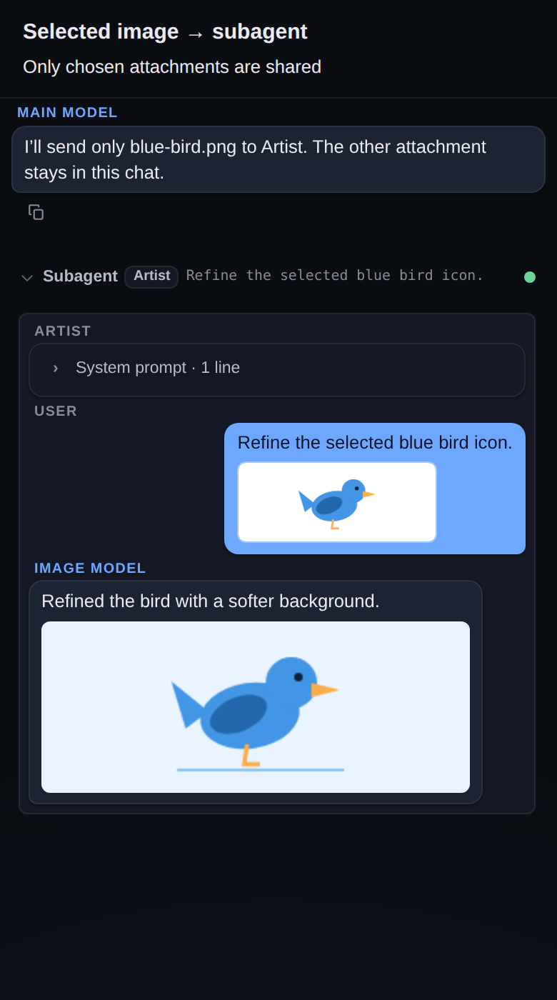

# Subagent image generation

## Overview

An agent pinned to an image model can generate artwork natively through OpenRouter or Gemini. Generated pixels appear in its nested transcript and return to the parent assistant as vision content, rather than disappearing into an empty successful response.

## Usage

1. Connect an OpenRouter or Gemini provider in Settings → Providers.
2. In Settings → Project → Agents, pin an agent to an image model and write its drawing instructions.
3. Approve a `subagent` delegation to that agent, or send an `@` command:

```text
@Artist Draw a simple blue bird icon on a white background.
```

Tap the resulting image to enlarge it. When a reply includes text and artwork, both remain visible in the nested bubble. Direct `@agent` image results persist as a subagent tool card and an assistant billing row, so the artwork remains after reload. Generating an image does not attach it to the composer draft or start another chat turn. Normal subagent authorization still applies.



*Illustrative fixture captured with the real mobile chat renderer; the example artwork is drawn locally, not generated by a paid provider.*

### Send only selected attachments

Chat images are **never forwarded automatically**. The main model first calls `list_chat_attachments`, chooses the desired `imageRef` values, and passes them in `subagent.images`:

```json
{
  "task": "Describe this screenshot and suggest a simpler layout.",
  "agent": "Reviewer",
  "images": ["message:12:0"]
}
```

Omitting `images`, or passing `[]`, sends no images even when the parent chat has attachments. References are scoped to the current chat: message references contain its stable sequence and image index; draft references identify the exact image contents and remain valid across reordering, but not replacement/removal. Relist attachments after an `ENOTFOUND` response. At most eight images and 24 MiB of encoded input can be selected.

The selected pixels are resolved server-side after delegation authorization and included in the nested user message, live prompt preview, and settled transcript. They are not copied to project files, removed from the draft, or returned as newly generated artwork. Use a vision-capable model. Selecting an image for a Gemini image-chat or supported OpenRouter image model also enables reference-image editing; Imagen `predict` rejects image inputs rather than silently dropping them.

`POST /api/tools/subagent` accepts the same optional `images` reference array. The composer does not automatically add draft images to an `@agent` command.

## Behavior

- OpenRouter's dedicated image catalog (`/images/models`) resolves to `POST /images` with a prompt, `n: 1`, and a non-streaming JSON response. The parser accepts `data[].b64_json` and `media_type`, and preserves `usage.cost` for billing. Catalog data can supply selection metadata only; it cannot replace the app connection's URL or credentials.
- OpenRouter image-capable chat models use `/chat/completions` with `modalities`, and parse inline `images[].image_url.url` from streamed deltas or message objects.
- Gemini Imagen uses `:predict` with one instance and `sampleCount: 1`. Gemini image chat models use `streamGenerateContent` with `responseModalities: ["TEXT", "IMAGE"]`, and parse `inlineData` (or `inline_data`). Thinking-image parts are not exposed as artwork.
- Dedicated image calls do not advertise tools. They retain the chat loop's abort signal, idle timeout, error handling, and per-round usage accounting.
- The normalized `image` event carries `{ type, data, mimeType }`. A delegated assistant turn stores its image blocks in `images`; the subagent result also carries them in `content` for parent vision feedback. Base64 is omitted from the textual tool feedback.
- Each generated image must be inline PNG, JPEG, WebP, or GIF and at most 12 MiB of encoded data; at most eight images are accepted per run. Remote output URLs are rejected rather than fetched with provider credentials. Image-only calls returning no pixels fail with `ENO_IMAGE` instead of claiming success.
- OpenRouter `/images` receives explicitly selected images as `input_references`, validated against the model's reported minimum and maximum reference count before sending. Gemini image chat uses inline image parts. Imagen input-image editing and asynchronous/long-running prediction APIs are not implemented.

## Verification

```bash
node scripts/test-subagent-images.js
node scripts/test-subagent-image-inputs.js
npm run test:subagent-prompt
node scripts/test-read-image-preview.js
```

The generation tests use mocked providers, not paid upstream calls.
